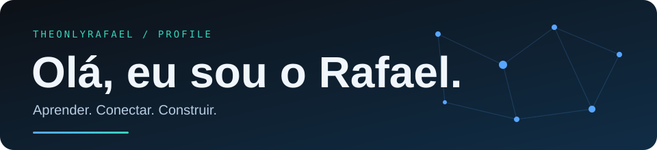

  

**Estudante de graduação em Sistemas de Informação na Universidade Federal de Uberlândia (UFU).**

  

  <a href="#-formação">Formação</a> · <a href="#-por-aqui">Repositórios</a> · <a href="#-vamos-conversar">Contato</a>

---

## 🎓 Formação

Estou cursando a **graduação em Sistemas de Informação pela Universidade Federal de Uberlândia (UFU)**. Este perfil é um espaço para compartilhar minha trajetória acadêmica e o que eu construir ao longo dela.

> **Aprender. Conectar. Construir.**
> Da curiosidade à próxima ideia, um passo de cada vez.

## 🧭 Por aqui

Um espaço para reunir estudos, exercícios e projetos da minha jornada em Sistemas de Informação — conectando teoria e prática.

[**Explorar meus repositórios →**](https://github.com/theonlyrafael?tab=repositories)

## 💬 Vamos conversar?

  
  

---

Rafael Fraga · Sistemas de Informação · UFU

